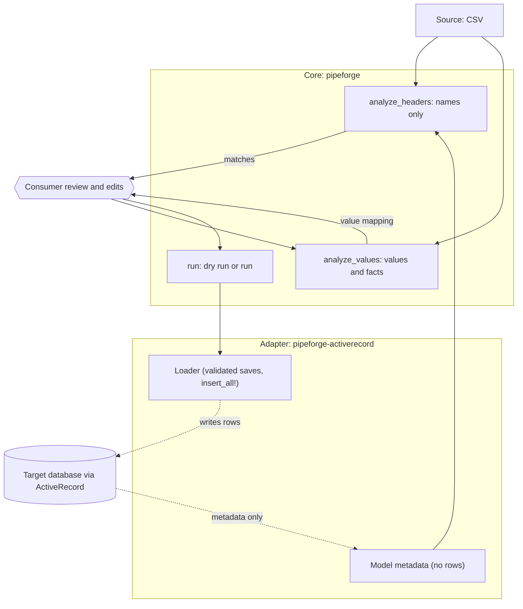

# Relational Data Migration Engine

> A relational data migration engine for Rails applications. It checks a source file against your ActiveRecord models, measures the values, lets you map names and values to what the database stores, and loads the rows — with deterministic, explainable facts at each step, a dry run that reports what a real run would do, and options that let you say *how* a migration should behave while the engine handles the rest.

## About

Most of my backend work has involved data migrations that were never as simple as "read a CSV, insert rows" — large customer migrations (some north of 10 lakh records) from CSV/JSON exports, API-based migrations, and incremental syncs that had to keep running safely long after the initial load. Every one of them hit the same friction:

- Fields that didn't map cleanly onto the target schema
- The same value showing up in three different forms across customers
- Records that were invalid, missing, or silently blocked
- Foreign keys that only resolved correctly against the real state of the target database

The hard part was never parsing the input — it was everything around it: mapping source to target with enough confidence to explain *why* a mapping was chosen, catching bad data before it reached the database, staying practical at volume, and being able to see what a migration would do before it does it. In practice that meant a new one-off script per migration, tightly coupled to a specific Rails app, unreusable, and opaque about why any decision was made.

This engine is the fix: a **migration engine built on ActiveRecord**. You give it a source file and a target model, and call three stages. The first checks the column names. The second measures the values, with the distinct values you need for value mappings. The third checks everything again and loads, either as a dry run or for real, and reports the rows that failed.

## Architecture

The engine has two parts. The **core** (`pipeforge`) has no database library. The **adapter** (`pipeforge-activerecord`) reads the model's metadata and loads the rows. You install only the adapter; the core comes with it.



Header and value analysis never read existing target rows. Only the loader writes rows, and the model's own validations check parent records as they load.

This is a simplified view. The full topology, the stage contracts and the end-to-end sequence diagram are canonical in [`docs/architecture/overview.md`](docs/architecture/overview.md); every other doc refers back to that file.

## Trying it by hand

The repository has a small sample database and sample source files, so you can try the engine without setting anything up. From the repository root:

```bash
bundle install
bundle exec script/console
```

This creates `tmp/development.sqlite3` (two tables: `users`, the target, and `companies`, the table its foreign key points to), then opens a Ruby console with the engine and the models loaded. Running it again recreates the database, so the data is always the same. Try:

```ruby
engine = Pipeforge::Engine.new(source_io: File.open("script/sample_data/users.csv"), target_table: "users")
result = engine.analyze_headers
result.matches                   # target column => {source_column:, score:, metadata:}
result.unmatched_source_columns  # source columns that matched no target column
result.unmatched_target_columns  # [{name:, metadata:}] for the target columns left without a match
```

| Sample file | What it shows |
|---|---|
| `script/sample_data/users.csv` | Clean headers and values that fit: every column matches, and the `Company` column holds company ids |
| `script/sample_data/users_messy_headers.csv` | Headers that are only partly recognizable: some matches, some columns left unmatched |
| `script/sample_data/users_bad_values.csv` | The right headers, but values that do not fit their columns (`forty` for an age, `maybe` for a boolean, a name where an id is expected) |

To measure the values of a file, pass the columns you mapped to `analyze_values`, as a plain Hash keyed by target column that you build yourself. Every required target column (NOT NULL in the table, with no default in the table or the model; the timestamps a model fills on save do not count; the header result's metadata shows which) needs an entry:

```ruby
engine = Pipeforge::Engine.new(source_io: File.open("script/sample_data/users_bad_values.csv"), target_table: "users")
values = engine.analyze_values(mapped_columns: {
  "email" => {source_column: "Email"},
  "first_name" => {source_column: "First Name"},
  "last_name" => {source_column: "Last Name"},
  "company_id" => {source_column: "Company"},
  "age" => {source_column: "Age"}
})
values.columns["age"].type_compatibility   # {fits: 3, total: 4}
values.columns["age"].distinct_values[:incompatible].values   # the values that do not fit
```

The engine finds the model of the target table among the models that are loaded and never loads any itself. Loading them, and how, is your choice; the model of the target table must be loaded before `analyze_headers`, otherwise it stops with `active_record_model_not_found`.

The public API is `Pipeforge::Engine`, the result objects it returns, the errors under `Pipeforge::*Error` (each with a stable `code`) and `Pipeforge::Configuration`. Everything else is internal and may change in any release.

The seed script alone is `bundle exec ruby script/seed_development.rb`. The settings are read from `config/pipeforge.yml` if you add one; without it every setting has its default.
