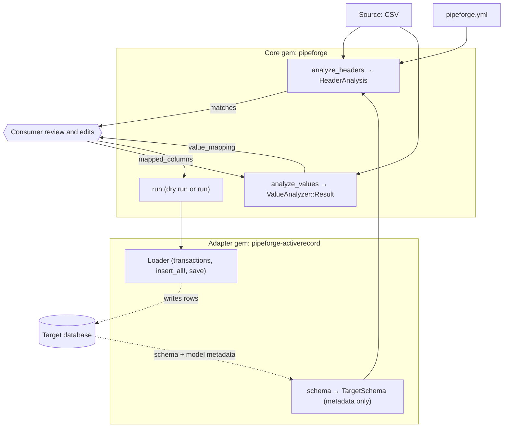
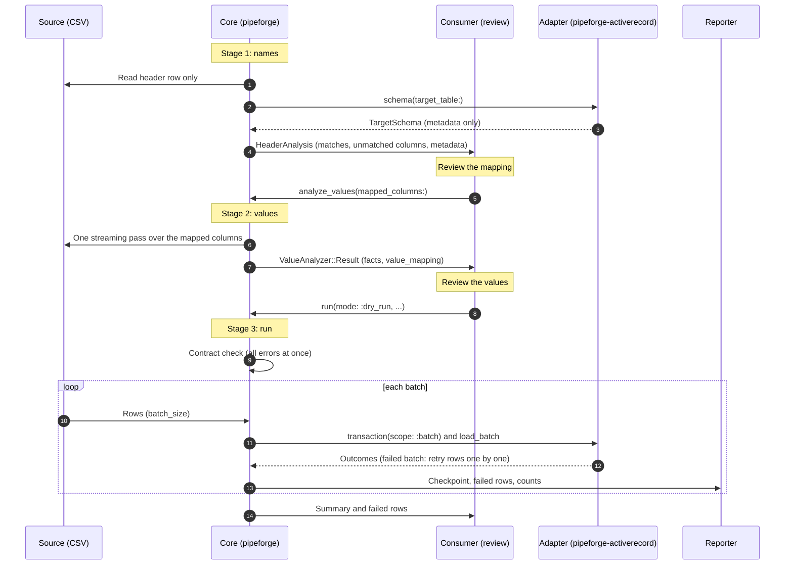

# Architecture Overview & System Topology

> **Document Location:** `docs/architecture/overview.md`
> **Status:** Draft v4.0 — updated 2026-10-25: stages are independent public calls and the fingerprints are removed (ADR-18 amendment of 2026-10-25); the inputs of `run` are still to be settled
> **Index:** [Master Documentation Index](../../README.md)

---

## 1. Foundational Principles

The **Relational Data Migration Engine** migrates data from a source file into a relational database. The consumer states *how a migration should behave*; the engine checks the source against the target, measures the values and loads the rows.

CSV is the **current MVP source format**. It is not the system identity; other source formats may be added later without changing the stage design.

The engine is split into a **framework-agnostic core** (`pipeforge`) and one **adapter distribution per database library** (`pipeforge-activerecord` for the MVP). The consumer installs only the adapter (ADR-16).

### 1.1 Minimal Consumer Effort
The consumer does not write connections or loaders. They supply a source, name the target table, and set behavior options. The adapter is built in. Custom adapters are an advanced extension point (see `target-access.md`).

### 1.2 The Row-Access Boundary
Analysis must never depend on what is already in the target database.

* **Allowed everywhere (metadata only):** columns, types, nullability, defaults, primary and foreign keys, unique indexes, and model metadata (enums, associations, virtual attributes, validators).
* **Forbidden outside the loader:** reading existing target rows, value distributions of the target, or "is this table empty?" checks.
* **Row-access module:** only the **loader** touches business rows, and it does so inside the model's own validations (ADR-15). The header stage and the value stage read only the source file and target metadata. The value stage reads source values, which is not target access.

### 1.3 Schema Is Structural Truth, Not Business Truth
The catalog says `users.status` is a `VARCHAR(50)`; it does not say which values are allowed. Allowed values are known only from model metadata (for example an `enum` declaration), never inferred from stored data.

### 1.4 Staged Engine Methods (ADR-14, ADR-17)

```text
Engine.new(source_io:, target_table:)      the source and the target table, given once
analyze_headers                           → HeaderAnalysis      (names only, no values)
analyze_values(mapped_columns:)           → ValueAnalyzer::Result (values, facts, value mappings)
run(mode: :dry_run | :run, ...)           → summary and failed rows (inputs to be settled)
```

1. **`analyze_headers`** reads the source header and the target model's columns, and ranks source columns against target columns **by names only** (ADR-12). It returns the best matches, keyed by target column, with the metadata of each target column, and the columns left unmatched.
2. **`analyze_values`** takes the mapping the consumer settled (target column => source column) and measures the mapped columns in one pass: empty counts, how many values fit the target type, distinct values, and the consumer's `value_mapping`. Calling it again after an edit shows the facts again.
3. **`run`** is the one public runtime entry point. It checks its input against the source and the target schema, then loads. `mode: :dry_run` rolls everything back; `mode: :run` commits. The stages are public calls that do not depend on each other's output (ADR-18 amendment of 2026-10-25), so a consumer may call `run` without the other two; its exact inputs (the mapped columns with their value mappings) are settled in the run contract.

There is no separate build step: the consumer already has the header and value results, which show the plan. Review is the consumer's own step; the engine never prompts and never resets anything.

### 1.5 Results Are Plain Values
Each stage returns an immutable value object that can be stored, shown and passed back. Facts are regenerated each time; state (the mapping and the value mappings) is what the consumer edits.

### 1.6 Contracts Between Components
Stages communicate through explicit value objects (P1–P2, `HeaderAnalysis`, `ValueAnalyzer::Result`, checkpoints) and not through shared mutable state or ad hoc hashes. Only artifacts that cross a process or storage boundary carry a `protocol_version`. See `protocols.md`.

### 1.7 Deterministic Core
Recommendations are **deterministic**, **explainable**, **reproducible** and **testable**. Identical inputs and configuration produce identical results. No LLM or external AI service participates in correctness.

---

## 2. System Topology



Source analysis and target schema reading are independent and may run concurrently.

---

## 3. Stage Responsibilities

### 3.1 `analyze_headers`
* **Input:** the source file and the target table (named by table name), both given to `Engine.new`.
* **Reads:** the source header row only, and the target model's metadata.
* **Output:** `HeaderAnalysis`: `matches` keyed by target column (source column, score, `tied_with`, and the metadata of the target column, including its foreign key), `unmatched_source_columns`, and `unmatched_target_columns` (name and metadata). A source column is shared by the targets that have the same score for it, and the consumer chooses.
* **Non-responsibilities:** no values, no data-based ranking, no invented mappings.

### 3.2 `analyze_values`
* **Input:** the mapped columns, a plain Hash the consumer builds, keyed by target column (each entry names its source column and an optional value mapping). Every required target column needs an entry; a source column may feed several target columns. The type, size and precision of each target column are read from the target table's schema (ADR-18), never sent by the consumer.
* **Reads:** the mapped source columns only, in one streaming pass with bounded memory, and the schema of the target table (metadata only).
* **Output:** `ValueAnalyzer::Result`: per column, empty count, type compatibility (`fits` of `total`), distinct values split into compatible and incompatible lists (capped per list), and the value mapping the facts were measured with.
* **Non-responsibilities:** no writes, no target rows, no changes to the mapping.

### 3.3 `run`
* **Input:** `mode`, what it needs to load (the mapped columns with their value mappings; to be settled in the run contract), and the optional offset, limit and per-call options. Offset and limit are not built yet.
* **Checks first:** every mapped column exists in the source and the target; every required target column is mapped. All errors are reported at once, before any row is read.
* **Loads:** streams the source in batches. Each batch is loaded through the adapter, a failed batch is retried row by row, and each committed batch leaves a checkpoint.
* **Output:** a summary (`mode`, loaded and failed counts, checkpoint) and the failed rows, one JSON line each.
* **Dry run:** the same path, inside one outer transaction that is rolled back at the end (`target-access.md` §4).

### 3.4 The Consumer Boundary
The consumer owns: reviewing and editing the stage results, where they are stored, **when** to call each method, the choice of offset slices, and the decision to run during low traffic (the dry run holds locks). The engine never prompts and never becomes a web app. Progress is surfaced through consumer-supplied hooks, not terminal UI.

---

## 4. End-to-End Information Flow


